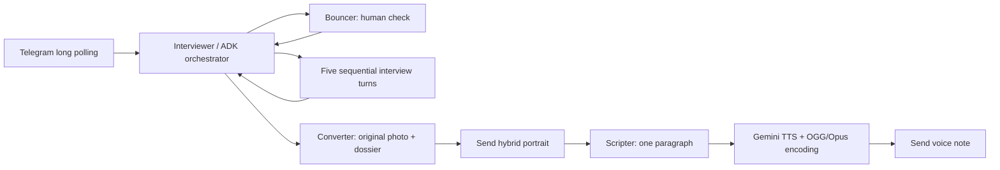

# The Telegram Documentaries

Turn a portrait into a funny wildlife documentary: five interview questions,
a human–animal hybrid portrait, a short script and a narrated Telegram voice note.

## Setup on Windows (PowerShell)

Python 3.11 or 3.12 is recommended. From the project directory:

```powershell
python -m venv .venv
.\.venv\Scripts\python.exe -m pip install -r requirements.txt
Copy-Item .env.example .env
```

Fill in `.env` locally with a Telegram BotFather token and a
[Gemini API key](https://aistudio.google.com/apikey). Never commit this file.
For this workspace the provided keys have already been saved locally.

```powershell
.\.venv\Scripts\python.exe -X utf8 -m tele_bot.main
```

The bot runs while this process is running. Stop it with Ctrl+C. For the hidden
process started during development, stop only this bot with:

```powershell
Stop-Process -Id (Get-Content .bot.pid)
```

On macOS/Linux, create and activate `.venv`, install `requirements.txt`, copy
`.env.example` to `.env`, then run `python -m tele_bot.main`.

Only one process should poll a bot token at a time. Stop the old Codio bot before
using this copy if Telegram reports a polling conflict. No public URL or webhook
is required. Sessions are in memory and disappear when the process stops.

## Try it in Telegram

1. Open your bot's private chat and send `/start`.
2. Send a non-human photo to check rejection, then a clear selfie as a photo.
3. Answer five questions, one at a time.
4. Receive the animal hybrid portrait, 60–90 word script and OGG/Opus voice note.
5. Send `/restart` and complete a second run without restarting Python.

Your photo and answers are sent to Gemini. Bot-side media stays in memory and
is released after use; ADK history is cleared after every turn. Idle sessions
expire after an hour. This does not delete copies held by Telegram or Google.

| Command | Effect |
| --- | --- |
| `/start`, `/restart` | Cancel active work, clear this chat's state and begin again |
| `/retry` | Resume a failed stage without repeating completed stages |
| `/help` | Show instructions |

## Architecture and specs

Google ADK runs four agents. The Interviewer is the root orchestrator and owns
an explicit state machine; it delegates vision, portrait generation and writing
to the Bouncer, Converter and Scripter. Narration is a direct Gemini integration.



`SPECS/MISSION.md`, `SPECS/TECH.md` and `SPECS/ROADMAP.md` define the project.
`SPECS/2026-10-15-documentary/` records requirements, implementation plan and
validation. Feature specs and failing tests precede implementation.

Default models: `gemini-3.1-flash-lite`, `gemini-3.1-flash-image` and
`gemini-3.1-flash-tts-preview`. Override `TEXT_MODEL`, `IMAGE_MODEL`, `TTS_MODEL`
and `TTS_VOICE` in `.env` if your course/API access changes. The defaults follow
the lesson; 3.1 TTS is a legacy preview. Model listing does not guarantee quota.
API calls may require billing. `/retry` cannot resolve exhausted quota.

FFmpeg is bundled through `imageio-ffmpeg`; a separate system installation is
unnecessary. PCM audio is encoded through pipes, leaving no temporary media files.
`requirements.txt` pins direct dependencies; `requirements-lock.txt` records
all packages resolved in the tested Python 3.12 Windows environment.

## Development checks

```powershell
.\.venv\Scripts\python.exe scripts/dev.py check
.\.venv\Scripts\python.exe -m pre_commit install
.\.venv\Scripts\python.exe -m pre_commit run --all-files
```

The portable runner invokes `ruff check`, `ruff format --check`, `mypy` and
`pytest`. POSIX wrappers are `scripts/test` and `scripts/hooks`; PowerShell
wrappers are `scripts/test.ps1` and `scripts/hooks.ps1` (activate `.venv` first).
The pre-commit hook runs these checks plus Gitleaks; its initial installation
needs network access. API tokens and SDK exception URLs are redacted in logs.

Offline tests use stubbed services with a real ADK runner. Live checks are opt-in:

```powershell
.\.venv\Scripts\python.exe -X utf8 scripts/check_live.py
```

This makes small billable Gemini calls, checks Telegram credentials, and tests
question generation, profiling, scripting, vision, image generation and audio.
It sends no Telegram messages and writes no generated media. Its sample portrait
is a drawing, so a successful smoke check does not replace a real selfie test.
The original Bouncer-only integration tests can be run with `pytest -m live`.
